# flutter_unity_widget

[🇺🇸 English](README.md) | [🇨🇳 简体中文](README.zh.md)

[](#contributors-)

[![version][version-badge]][package]
[![MIT License][license-badge]][license]
[![PRs Welcome][prs-badge]](https://makeapullrequest.com)

[![Watch on GitHub][github-watch-badge]][github-watch]
[![Star on GitHub][github-star-badge]][github-star]

[](https://gitter.im/flutter-unity/community?utm_source=badge&utm_medium=badge&utm_campaign=pr-badge)
[](https://discord.gg/KmMqD7Sv3K)

在 Flutter 中嵌入 Unity 3D 场景的组件。你可以在 Unity 中为应用制作游戏化功能，并以全屏或可嵌入模式渲染到 Flutter 应用中。支持 `Android、iPadOS、iOS、Web`。

<br />

### 注意事项
- 请使用 Windows 或 Mac 导出并构建项目。  
  Ubuntu 用户反馈 Unity 导出报错较多。
- 模拟器支持有限且需要特殊配置。Android 和 iOS 仍建议优先使用真机；预编译产物模式下已验证的 arm64 模拟器/仿真器配置见 [`example/README.md`](example/README.md)。
- 支持 Unity 2019.4.3 至 2022.3.x，推荐最新的 2022.3 LTS。  
  Unity 6 的支持情况见[这个 issue](https://github.com/juicycleff/flutter-unity-view-widget/issues/967)。  
- 为保证 AR 兼容性，Android 的 Graphics API 请只使用 OpenGLES3。  
- 因缺少 [Flutter PlatformView 支持](https://github.com/flutter/flutter/issues/31713)，不支持 Windows。  

## 预编译产物集成模式

本 fork 以**预编译产物**方式集成 Unity 导出结果，而非源码工程——Flutter 开发机无需安装 Unity、无需保留 Unity 导出源码，只需要编译好的产物。

| | 上游 | 本 fork |
|---|---|---|
| Android | Unity 导出源码工程放在 Flutter 工程内，以 `implementation project(':unityLibrary')` 引用 | 导出一次性编译为 `unityLibrary.aar` + `unity-classes.jar`，经 `flatDir` 引用 |
| iOS | Unity 导出的 Xcode 工程合并进 Flutter 工程 | 导出一次性 archive 为 `UnityFramework.framework`，经 framework 搜索路径链接 |
| Flutter 开发机 | 需要磁盘上保留 Unity 导出工程 | 只需要预编译产物 |

### 构建脚本

[`example/`](example/) 示例应用内置两条流程的实测自动化脚本：

- [`example/build_unity.sh`](example/build_unity.sh) —— 一键入口，串联三个目标（`android`、`ios device`、`ios simulator`）的整条流水线：Unity 批量导出到 `unity/flutter/<平台>/`、平台构建、产物回拷部署到 `android/unityLibrary/` 与 `ios/UnityLibrary/`。
- [`example/android/build_unity.sh`](example/android/build_unity.sh) —— Android 阶段：向导出工程的 `build.gradle` 幂等注入 `maven-publish` 发布配置与 `flatDir` 仓库，执行 `publishReleasePublicationToAndroidBuildRepo`，校验 AAR 含 `arm64-v8a` 原生库，最后部署 `unityLibrary.aar` + `unity-classes.jar`。
- [`example/ios/build_unity.sh`](example/ios/build_unity.sh) —— iOS 阶段：archive `UnityFramework` scheme（`device` / `simulator` 自动检测），校验 framework 完整性（arm64 slice、`_OBJC_CLASS_$_UnityAppController`、`_il2cpp_init` 导出符号），部署平台名与通用名双份 `UnityFramework.framework`，并对模拟器构建做 `libiPhone-lib.dylib` 瘦身与重签。同时修复模拟器 archive 时 Unity 生成的 `libGameAssembly.a` 构建输入缺失问题。

下方手动步骤描述的正是这些脚本所做的事；仅在你希望手工操作时才需要它们。

### Android：unityLibrary.aar

1. 从 Unity 导出 Android 库（`Flutter > Export Android (Release)`）。导出产物是独立的 `unityLibrary` Gradle 工程。
2. 编译为 AAR。在导出工程的 `build.gradle` 中幂等注入 `apply plugin: 'maven-publish'`，发布坐标 `com.unity3d.player:unityLibrary` 到本地 Maven 仓库，并添加 `flatDir { dirs 'libs' }` 仓库，然后执行：

   ```bash
   ./gradlew :unityLibrary:publishReleasePublicationToAndroidBuildRepo
   ```

3. 将发布出的 `unityLibrary-unspecified.aar` 复制为 `<flutter>/android/unityLibrary/unityLibrary.aar`，连同导出的 `libs/unity-classes.jar` 一起部署。
4. 校验 AAR 确实包含原生库：`unzip -l unityLibrary.aar | grep arm64-v8a`。现代手机全部为 arm64——缺失 ABI 时编译正常，但所有机型运行即闪退。

插件的 `android/build.gradle` 已按此方式消费产物：

```gradle
flatDir { dirs "${rootProject.projectDir}/unityLibrary" }   // 仓库
implementation(name: 'unityLibrary', ext: 'aar')
implementation(name: 'unity-classes', ext: 'jar')
```

应用侧配置（已在 [`example/`](example/) 中验证）：

- **不要**在 `settings.gradle` 中 `include ':unityLibrary'`——部署目录里只有 AAR/JAR，没有 `build.gradle`。
- **不要**在 `app/build.gradle` 里重复声明 AAR/JAR 依赖——插件已声明过两者，重复会导致 `Duplicate class` 错误。应用层只需要 `implementation project(':flutter_unity_widget')`。
- 在根项目用 `flatDir { dirs "${rootProject.projectDir}/unityLibrary" }` 仓库解析 AAR 目录。
- Kotlin Gradle 插件版本与插件的 Kotlin stdlib 对齐（2.1.20）——旧编译器读不了新 stdlib 的 metadata。
- 应用 `compileSdk` 设为 36。

### iOS：UnityFramework.framework

1. 从 Unity 导出 iOS（`Flutter > Export IOS (Release)`）。导出产物是 `Unity-iPhone.xcodeproj` 工程。
2. archive `UnityFramework` scheme：

   ```bash
   xcodebuild archive -project Unity-iPhone.xcodeproj -scheme UnityFramework \
       -sdk iphoneos -arch arm64 -configuration Release \
       -archivePath build/UnityFramework.xcarchive \
       SKIP_INSTALL=NO BUILD_LIBRARY_FOR_DISTRIBUTION=YES CODE_SIGNING_ALLOWED=NO
   ```

3. 将 `build/UnityFramework.xcarchive/Products/Library/Frameworks/UnityFramework.framework` 复制到 `<flutter>/ios/UnityLibrary/UnityFramework.framework`。
4. 部署**之前**先校验 framework——被剥除符号的残缺版仍能链接通过，但运行时会崩溃或链接失败：
   - `lipo -archs UnityFramework` 包含 `arm64`
   - `nm -g UnityFramework` 导出 `_OBJC_CLASS_$_UnityAppController`（ObjC 类必须是全局可见符号，否则 Flutter 链接报 `Undefined symbol`）
   - `nm -g UnityFramework` 导出 `_il2cpp_init`（Unity 原生跳板用 dlsym 加载 il2cpp；缺失则运行时崩溃 "Could not load symbol il2cpp_init"）

插件的 `ios/flutter_unity_widget.podspec` 已按此方式消费 framework：

```ruby
'FRAMEWORK_SEARCH_PATHS' => '"${PODS_ROOT}/../UnityLibrary" ...',
'OTHER_LDFLAGS' => '$(inherited) -framework UnityFramework ${PODS_LIBRARIES}'
```

应用侧配置（已在 [`example/`](example/) 中验证）：

- 按路径引用 `UnityLibrary/UnityFramework.framework`，不要用 `BUILT_PRODUCTS_DIR`，Embed Frameworks 阶段才能拷到预编译产物。
- Runner target 与所有 Pods 的 `IPHONEOS_DEPLOYMENT_TARGET` 设为 15.0 及以上（当前 Xcode 的模拟器 SDK 拒绝更低值）。
- framework 为 arm64-only：Runner target 与所有 Pods 需排除 x86_64，即 `EXCLUDED_ARCHS[sdk=iphonesimulator*] = x86_64`（手工编辑 `project.pbxproj` 时条件键必须带引号）。
- 新 SDK 强制 UIScene 生命周期：`Info.plist` 声明 `UIApplicationSceneManifest`，并返回 `delegateClass` 为 `FlutterSceneDelegate` 的 `UISceneConfiguration`。Unity 仍在 `didFinishLaunchingWithOptions` 中通过 `InitUnityIntegrationWithOptions` 初始化。
- `flutter pub get` 之后执行 `pod install`。

### 补充说明

- 下文上游的 **Platform specific setup**（Gradle `settings.gradle` 源码工程接线 / Xcode 工程合并）步骤在本模式下**已被替代**——可跳过。
- 插件仓库自带 `android/libs/unity-classes.jar`；部署到 `<flutter>/android/unityLibrary/` 的副本请与 Unity 版本保持同步。
- iOS 模拟器构建需要专门的导出方法：切换 SDK 为 `SimulatorSDK`，**并强制模拟器架构为 ARM64**（`PlayerSettings.iOS.simulatorSdkArchitecture = AppleMobileArchitectureSimulator.ARM64`）——Unity 2022.3 默认 x86_64，会产出与 arm64 不兼容的 `libil2cpp.a`，导致 framework 内没有任何 il2cpp 符号。示例工程已内置该 wrapper：[`example/unity/DemoApp/Assets/Editor/SimulatorExport.cs`](example/unity/DemoApp/Assets/Editor/SimulatorExport.cs)。模拟器 archive 时 `OTHER_LDFLAGS` 需保留 Unity 工程自身的框架链接参数（覆盖为 `$(OTHER_LDFLAGS_FRAMEWORK) -ObjC -Wl,-undefined,dynamic_lookup -Wl,-force_load,$(BUILT_PRODUCTS_DIR)/libGameAssembly.a`）；`libil2cpp.a` 存在编译期引用，无需额外 `force_load`。

## 声明
需要我回应的话，请 @ [Rex Isaac Raphael](https://github.com/juicycleff)。

使用本插件的前提是你至少会使用 Unity 引擎。如果你对 Unity 组件的呈现方式有异议，可以按需自行调整 Unity 工程的构建设置。

后续版本号将经过充分测试后与 Unity 版本号对齐。这不代表本插件不兼容其他 Unity 版本，只是表示已针对该版本做过测试。

## 安装

本插件要求 Flutter >= 3.16.0。

先在应用的 `pubspec.yaml` 中添加依赖：
```yaml
dependencies:
  flutter_unity_widget: ^2022.2.1 # 使用最新的兼容版本
```

然后在 Dart 代码中导入即可。

```dart
import 'package:flutter_unity_widget/flutter_unity_widget.dart';
```

你需要打开并导出一个 Unity 工程，即使只是运行示例。只把组件放进 Flutter 而不导出 Unity，构建会失败！


## 预览

30 fps 的 gif，展示 Flutter 与 Unity 的通信效果：

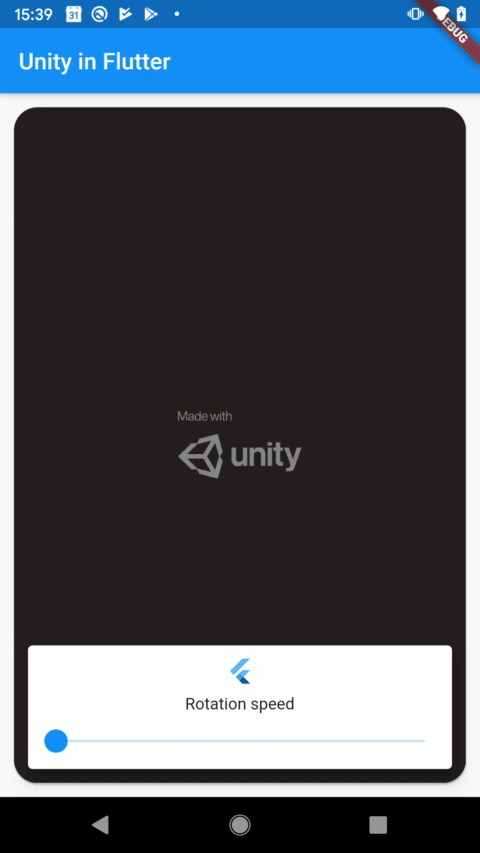
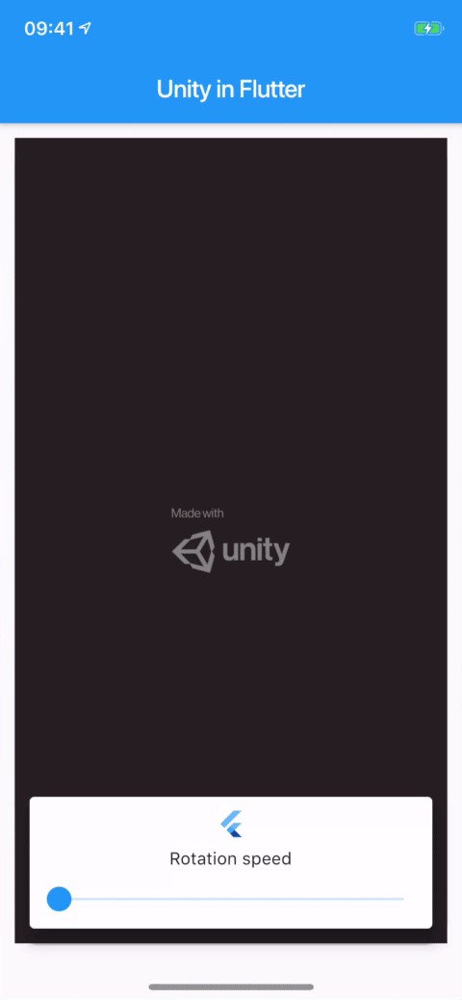

<br />

## 配置

下面的教程中，各平台专属步骤会以 ℹ️ 图标加平台名（Android 或 iOS）标注。点击图标可展开。

### 前置条件

- 一个已有的 Flutter 工程（没有的话可以[新建一个](https://flutter.dev/docs/get-started/test-drive#create-app)）

- 一个已有的 Unity 工程（没有的话可以[新建一个](https://learn.unity.com/tutorial/create-your-first-unity-project)）。

- 一个 `fuw-XXXX.unitypackage` 文件，见 [*unitypackages*](unitypackages) 目录。尽量使用最新的 unitypackage。

### 发布所需的 Unity 版本
如果要发布 Android 或 iOS 应用，需要满足特定的 Unity 版本要求。

**iOS**  
Apple 的[隐私清单要求](https://discussions.unity.com/t/apple-privacy-manifest-updates-for-unity-engine/936052)要求的最低 Unity 版本：
* 2021.3.35+ 
* 2022.3.18+
* 6000.0.0+

**Android**  
> 自 2025 年 11 月 1 日起，提交到 Google Play 且面向 Android 15+ 设备的所有新应用与更新必须支持 16 KB 内存页。

这要求 [Unity 版本](https://discussions.unity.com/t/info-unity-engine-support-for-16-kb-memory-page-sizes-android-15/1589588)：
* 2021.3.48+（仅 Enterprise 和 Industry）
* 2022.3.56+
* 6000.0.38+


### Unity 工程配置
以下步骤假设你使用一个新的 Unity 工程。如果直接使用本仓库的示例工程，可跳到下一节 **Unity 导出**。

1. 在 Flutter 工程目录下新建名为 *unity* 的文件夹，把 Unity 工程移进去。  
  Unity 导出会修改 Flutter 工程 `/android` 和 `/ios` 目录中的部分文件。Unity 工程放在其他位置时，导出可能（部分）失败。

  > 期望路径为 *<flutter-project>/unity/__project-name__/...*


2. 确认已下载 <b>前置条件</b> 中提到的 *fuw-XXXX.unitypackage* 文件。

3. 用 Unity（Hub）打开该工程。  
  进入 **Assets > Import Package > Custom Package**，选择下载的 *fuw-XXXX.unitypackage* 文件，点击 **Import**。

4. 进入 **File > Build Settings > Player Settings**，在 **Other settings > Configuration** 区域修改以下选项：

  - **Scripting Backend** 改为 IL2CPP

  - （Android）**Target Architectures** 勾选 ARMv7 和 ARM64

  - （Android）为获得最佳兼容性，将 **Active Input Handling** 设为 `Input Manager (Old)` 或 `Both`。  
    （新的输入系统在 Android 上有触摸问题）

  - （iOS）根据运行目标（模拟器或真机）选择 **Target SDK**。  
    由于模拟器支持有限，建议先从真机加 `Device SDK` 开始。

  - （Web）将 <b>Publishing settings > Compression format</b> 设为 Brotli 或 Disabled。  
  有用户反馈 Gzip 设置下 Unity 因 MIME 类型错误卡在加载界面。

  

5. 在 **File > Build Settings** 中，确保至少加入 1 个场景。


**Build settings** 窗口中的部分选项会被插件的导出脚本覆盖。
在此窗口修改 `Development Build`、`Script Debugging`、`Export project` 等设置不会生效。
如果需要修改一个改不动的构建设置，请查看导出脚本 `FlutterUnityIntegration\Editor\Build.cs`。

### Unity 导出

1. 导入 unitypackage 后，Unity 编辑器顶部会出现 **Flutter** 菜单。

2. 点击 **Flutter**，选择合适的导出项：

  - Android 用 **Export Android Debug** 或 **Export Android Release**。  
   导出到 *android/unityLibrary*。
  - iOS 用 **Export iOS Debug** 或 **Export iOS Release**。  
   导出到 *ios/UnityLibrary*。
  - 不要使用 **Flutter > Export _Platform_ plugin**，它是为大型项目配合 [`flutter_unity_cli`](https://github.com/juicycleff/flutter_unity_cli) 使用的。
 
  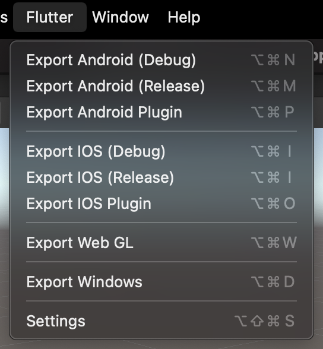
 
   如果你用 git，大概率要把这些 unityLibrary 目录加进 .gitignore。  
   这些目录可能非常大，且不保证在别的电脑上可用。


  接下来处理导出后的 iOS 和 Android 平台配置。

### 平台配置（Unity 导出后）
Unity 导出完成后，需要在 iOS 或 Android 工程中做少量修改。  
通常**只需做一次**，之后的 Unity 导出会保留这些修改。

<details>
<summary>ℹ️ <b>Android</b></summary>
  
1. 设置 Android NDK

  - 如果 Unity 和 Flutter 在同一台机器上，最简单的方式是使用 Unity 所用 NDK 的路径。在 Unity 的 `Edit -> Preferences -> External Tool` 中可以找到：

  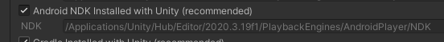

  - 复制该路径，粘贴到 Flutter 工程的 `android/local.properties` 中，形如 `ndk.dir=`。  
  （Windows 下需要把 `\` 换成 `\\`。）  
  不要直接照抄示例，务必确认路径与你自己的 Unity 版本匹配！  
```properties
    // mac
    ndk.dir=/Applications/Unity/Hub/Editor/2020.3.19f1/PlaybackEngines/AndroidPlayer/NDK
    // windows
    ndk.dir=C:\\Program Files\\Unity\\Hub\\Editor\\2021.3.13f1\\Editor\\Data\\PlaybackEngines\\AndroidPlayer\\NDK
```

  - 按上述方式配置后，gradle 文件中无需再定义任何 NDK 版本或设置。  
   如果执行 Flutter 构建的机器上没有 Unity，可以改为在 `android/app/build.gradle` 中定义。
```gradle

android {

  ndkVersion "21.3.6528147"
}
```
  - 要确认 Unity 使用的具体版本号，查看上述 NDK 路径下的 `source.properties`。


2. 视 gradle 版本而定，可能需要保证 `android\app\build.gradle` 中的 `minSdkVersion` 与 Unity 中设置的版本一致。  
查看 Unity Player Settings 中的 **Minimum API Level**，与之保持一致。

3. （可选）修复 Unity 插件问题。  
不做这一步 Unity 组件也能工作，但在较新的 Unity 版本上，ArFoundation 等部分 Unity 插件会抛 `mUnityPlayer` 错误。

    适用于 Unity 2020.3.46+、2021.3.19 - 2021.3.20 和 2022.2.4 - 2022.3.18。  
要求 flutter_unity_widget 版本高于 2022.2.1。


- 3.1. 打开 `android/app/build.gradle`，添加：

```diff
     dependencies {
         // build.gradle
+        implementation project(':flutter_unity_widget')
         // build.gradle.kts (Flutter 3.29+)
+        implementation(project(":flutter_unity_widget"))
     }
```
- 3.2. 修改 Android 的 MainActivity 文件。  
Flutter 默认路径为 `android/app/src/main/kotlin/<app identifier>/MainActivity.kt`。

  如果使用默认 Flutter Activity，改为继承 `FlutterUnityActivity`：
```diff
// MainActivity.kt

+ import com.xraph.plugin.flutter_unity_widget.FlutterUnityActivity;

+ class MainActivity: FlutterUnityActivity() {
- class MainActivity: FlutterActivity() {
```

- 3.2.（替代方案）如果使用自定义或改过的 Activity，改为实现 `IFlutterUnityActivity` 接口。

```kotlin
// MainActivity.kt

// 仅当你的 Activity 不继承 FlutterActivity 时才需要

import com.xraph.plugin.flutter_unity_widget.IFlutterUnityActivity;

class MainActivity: CustomActivity(), IFlutterUnityActivity {
    // Unity 会尝试读取 mUnityPlayer 属性
    @JvmField 
    var mUnityPlayer: java.lang.Object? = null;

    // 实现此方法以便插件设置 mUnityPlayer
    override fun setUnityPlayer(unityPlayer: java.lang.Object?) {
        mUnityPlayer = unityPlayer;
    }
}
```


4. 其余配置由 Unity 导出脚本自动完成。Android 配置到此结束。  
如果想手动了解导出做了哪些改动，请继续阅读。
  
<details> 
<summary> 可选：手动 Android 配置 </summary> 

5. 打开 *android/settings.gradle*，修改：

```diff
// build.gradle
+    include ":unityLibrary"
+    project(":unityLibrary").projectDir = file("./unityLibrary")

// build.gradle.kts (Flutter 3.29+)
+    include(":unityLibrary")
+    project(":unityLibrary").projectDir = file("./unityLibrary")
```

6. 打开 *android/app/build.gradle*，修改：

```diff
     dependencies {
          // app/build.gradle
+        implementation project(':unityLibrary')
         // app/build.gradle.kts (Flutter 3.29+)
+        implementation(project(":unityLibrary"))
     }
```

7. 打开 *android/build.gradle*，修改：

```diff
allprojects {
    repositories {
+       flatDir {
            // build.gradle
+           dirs "${project(':unityLibrary').projectDir}/libs"
            // build.gradle.kts (Flutter 3.29+)
+           dirs(file("${project(":unityLibrary").projectDir}/libs"))
+       }
        google()
        mavenCentral()
    }
}
```

8. 如需构建 release 包，打开 *android/app/build.gradle*，修改：

```diff
     buildTypes {
         release {
             signingConfig signingConfigs.debug
         }
+        debug {
+            signingConfig signingConfigs.debug
+        }
+        profile {
+            signingConfig signingConfigs.debug
+        }
+        innerTest {
+            matchingFallbacks = ['debug', 'release']
+        }
+   }
```

> 以上代码对所有 buildType 使用 `debug` 签名配置，如需指定签名可自行修改。

9. 如果在 *android/app/build.gradle* 中使用了 `minifyEnabled true`，打开 *android/unityLibrary/proguard-unity.txt*，修改：

```diff
+    -keep class com.xraph.plugin.** {*;}
```

10. 如果想让 Unity 运行在独立 Activity 中，打开 *android/app/src/main/AndroidManifest.xml*，修改：

```diff
+    <activity
+        android:name="com.xraph.plugin.flutter_unity_widget.OverrideUnityActivity"
+        android:theme="@style/UnityThemeSelector"
+        android:screenOrientation="fullSensor"
+        android:launchMode="singleTask"
+        android:configChanges="mcc|mnc|locale|touchscreen|keyboard|keyboardHidden|navigation|orientation|screenLayout|uiMode|screenSize|smallestScreenSize|fontScale|layoutDirection|density"
+        android:hardwareAccelerated="false"
+        android:process=":Unity">
+    <meta-data android:name="com.xraph.plugin.flutter_unity_widget.OverrideUnityActivity" android:value="true" />
+    </activity>
```
-----
</details>

-----
</details>


<details>
 <summary>ℹ️ <b>iOS</b></summary>

  1. 在 Xcode 中打开 *ios/Runner.xcworkspace*（workspace 而非 project），在 Navigator 空白处（不要点在具体条目上）右键，选择 **Add Files to "Runner"**，添加 *ios/UnityLibrary/Unity-Iphone.xcodeproj* 文件。
  
  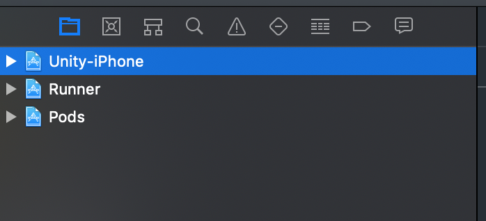
  
  2. （可选）选中 *Unity-iPhone/Data* 文件夹，把 Data 文件夹的 Target Membership 改为 UnityFramework。
  
  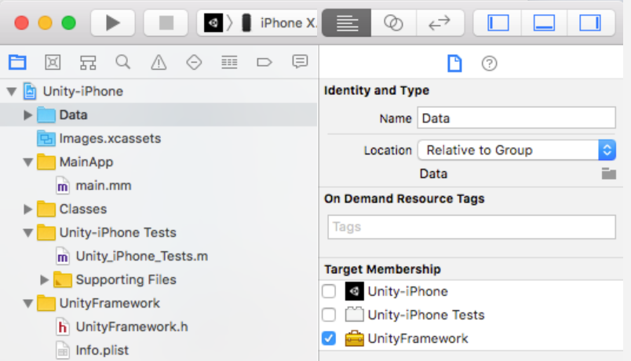
  
  3.1. 如果使用 Swift，打开 *ios/Runner/AppDelegate.swift*，修改：

```diff
     import UIKit
     import Flutter
+    import flutter_unity_widget

     @UIApplicationMain
     @objc class AppDelegate: FlutterAppDelegate {
         override func application(
             _ application: UIApplication,
             didFinishLaunchingWithOptions launchOptions: [UIApplication.LaunchOptionsKey: Any]?
         ) -> Bool {
+            InitUnityIntegrationWithOptions(argc: CommandLine.argc, argv: CommandLine.unsafeArgv, launchOptions)

             GeneratedPluginRegistrant.register(with: self)
             return super.application(application, didFinishLaunchingWithOptions: launchOptions)
         }
     }
```

   3.2. 如果使用 Objective-C，打开 *ios/Runner/main.m*，修改：
```diff
+    #import "flutter_unity_widget.swift.h"

     int main(int argc, char * argv[]) {
          @autoreleasepool {
+             InitUnityIntegration(argc, argv);
              return UIApplicationMain(argc, argv, nil, NSStringFromClass([AppDelegate class]));
          }
     }
```

  4. 将 *UnityFramework.framework* 作为库添加到 Runner 工程。
  
  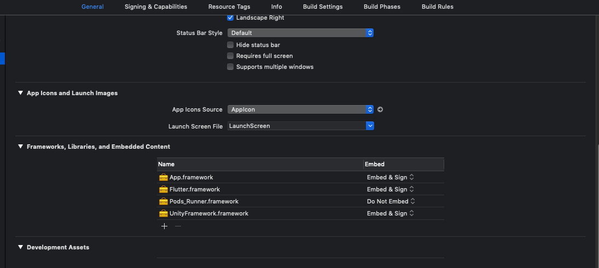
  
  5. 使用原生代码的 Unity 插件（Vuforia、openCV 等）可能需要像 UnityFramework 一样添加到 Runner。  
  查看 `/ios/UnityLibrary/Frameworks/` 目录内容。该目录（含子目录）中的任何 `<name>.framework` 都可以添加到 Runner。

  6. Unity 导出后确保 pods 已安装，可以用 `flutter run`，也可以在 ios 目录运行 `pod install`。

  7. 如果使用 Xcode 14 或更新版本，且 Unity 版本低于 2021.3.17f1 或 2022.2.2f1，从 Xcode 运行时应用可能崩溃。  
    在 Xcode 中关闭 `Thread Performance Checker` 即可解决。  
    - Xcode 菜单 `Product > Scheme > Edit Scheme...`  
    - 左侧选中 `Run`，切到 `Diagnostics` 标签，取消勾选 `Thread Performance Checker`。
-----
</details>

### 配置 AR

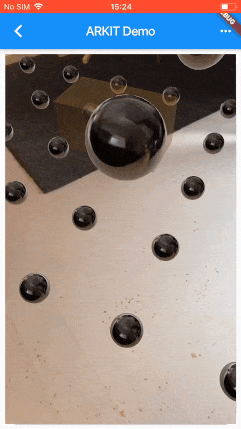

以下 AR 配置在 Unity 导出之后进行。

<b>警告：Flutter 3.22 在 Android < 13 上使用 AR 会崩溃 [#957](https://github.com/juicycleff/flutter-unity-view-widget/issues/957)</b>


<details>
 <summary>ℹ️ <b>AR Foundation Android</b></summary>

  1. 在 Unity 包管理器中检查 `XR Plugin Management` 版本。`4.3.1 - 4.3.3` 存在破坏 Android 导出的 bug。  
  请使用 <=`4.2.2` 或 >=`4.4` 的版本。  
  可能需要手动修改 `<unity project>/Packages/manifest.json` 中 `"com.unity.xr.management"` 的版本。


  2. 可以检查 `android/unityLibrary/libs` 目录确认 AR 是否正确导出。里面应包含 `UnityARCore.aar`、`ARPresto.aar`、`arcore_client.aar`、`unityandroidpermissions.aar` 等文件。

     如果配置和导出都正确，工程会自动加载这些文件。  
     如果没有，检查 `android/build.gradle` 是否包含 Android 配置第 7 步添加的 `flatDir` 段。

  3. 如果 `XR Plugin Management` 版本为 4.4 或更高，Unity 还会导出 xrmanifest.androidlib 目录。  
     在 `android/settings.gradle` 中加入以下行以确保包含它：
     ```
     // settings.gradle
     include ":unityLibrary:xrmanifest.androidlib"

     // settings.gradle.kts (Flutter 3.29+)
     include(":unityLibrary:xrmanifest.androidlib")
     ```
  4. 部分 Unity 版本下 AR 运行时会崩溃，报错类似：  
   `java.lang.NoSuchFieldError: no "Ljava/lang/Object;" field "mUnityPlayer" in class`。  
   修复方法见 Android 配置第 3 步中 MainActivity 的修改方式。

-----
</details>

<details>
 <summary>ℹ️ <b>AR Foundation iOS</b></summary>

1. 打开 *ios/Runner/Info.plist*，添加相机使用描述。例如：
```diff
     <dict>
+        <key>NSCameraUsageDescription</key>
+        <string>$(PRODUCT_NAME) uses Cameras</string>
     </dict>
```
-----
</details>

<details>
 <summary>ℹ️ <b>Vuforia Android</b></summary>

1. 导出结果应在 `android/unityLibrary/libs/` 目录包含 Vuforia 库，当前名为 `VuforiaEngine.aar`。

     如果配置和导出都正确，工程会自动加载该文件。  
     如果没有，检查 `android/build.gradle` 是否包含 Android 配置第 7 步添加的 `flatDir` 段。

如果此处内容过时或失效，请查阅 [Vuforia 官方文档](https://developer.vuforia.com/library/unity-extension/using-vuforia-engine-unity-library-uaal#android-specific-steps)

-----
</details>

<details>
 <summary>ℹ️ <b>Vuforia iOS</b></summary>

以下步骤基于 [Vuforia 文档](https://developer.vuforia.com/library/unity-extension/using-vuforia-engine-unity-library-uaal#ios-specific-steps)和[这条评论](https://github.com/juicycleff/flutter-unity-view-widget/issues/314#issuecomment-785302253)。

1. 打开 *ios/Runner/Info.plist*，添加相机使用描述。例如：
```diff
     <dict>
+        <key>NSCameraUsageDescription</key>
+        <string>$(PRODUCT_NAME) uses Cameras</string>
     </dict>
```
2. 在 Xcode 中：  
选中 `Runner` > `General` 标签。  
在 `Frameworks, Libraries, and Embedded content` 中添加 Vuforia framework。位置与 iOS 配置第 4 步添加 *UnityFramework.framework* 的地方相同。

    可以在 `/ios/UnityLibrary/Frameworks/com.ptc.vuforia.engine/Vuforia/Plugins/iOS/` 中找到，当前包括：
    - `Vuforia.framework`  
    - `UnityDriver.framework`

3. 要支持 Vuforia 目标数据库，把 `Unity-iPhone/Vuforia` 文件夹从 Unity-iPhone 移到 Runner，然后把该文件夹的 `Target Membership` 设为 Runner。

4. Unity 导出后确保 pods 已安装，可以用 `flutter run`，也可以在 ios 目录运行 `pod install`。

-----
</details>

## 模拟器
模拟器支持有限，建议使用 iOS 或 Android 真机。  
以下是有限的可用方案。

<details>
<summary>ℹ️  <b>iOS 模拟器</b> </summary>

Unity Player Settings 中的 `Target SDK` 选项很关键。  
- `Device SDK` 导出 ARM 构建（**不能**在 ARM 模拟器上运行）  
- `Simulator SDK` 导出面向模拟器的 x86 构建  


如果使用 ARKit 或 ARFoundation，iOS 模拟器不支持 ARKit，此路不通。

其余取决于 Mac 处理器类型：  
  
### （Apple Silicon）直接在 Mac 上运行

1. Unity 中以 `Device SDK` 为目标导出。  
2. Xcode 中打开 Runner 的 General 标签。  
3. 在 Supported destinations 中添加 `Mac (Designed for iPhone)` 或 `Mac (Designed for iPad)`。  
4. 选择它作为运行目标。  
5. 现在应用可以直接在 Mac 上运行，无需模拟器。

### （Intel 与 Apple Silicon）使用 x86 模拟器
1. Unity Player Settings 中设置 `Simulator SDK`。  
2. 确保 Unity 包管理器中没有 AR 或 XR 包。   
  （否则会报错 `symbol not found in flat namespace '_UnityARKitXRPlugin_PluginLoad`）  
  
3. （Apple Silicon）让 Xcode 使用 Rosetta 模拟器。  
  以下步骤假设 Xcode 14.3 或更新版本，旧版本请自行查找以 Rosetta 启动 Xcode 的方法。
  - Xcode 中 `Product -> Destination -> Destination Architectures`，确保 Rosetta 目标可见。  
4. 现在检查 Xcode 中的架构设置。  
5. 选中 `Unity-iPhone`，进入 `Build settings` -> `Architectures`。  
  如果以 Simulator SDK 导出，此处应只显示 `x86_64`。  
6. 选中 `Runner`，将架构改为与 Unity-iPhone 完全一致。  
  确保只有 `x86_64` 一项，而不是多项之一。  
7. 选中 `Pods`，在 targets 中点击 `flutter_unity_widget`。  
  再次进入 Build settings 的 Architectures，将 `Build Active Architecture Only` 设为 `YES`。  
  （我们要它只用当前活跃的 x86_64，不要回退到 arm。）   
8. 运行 `Product -> Clean Build Folder`，确保新的架构设置生效。  
9. 现在应能在 Rosetta 模拟器上启动 Runner。  
  Xcode 14.3+ 上模拟器名称应带 `(Rosetta)`。  
10. 视其他 Flutter 插件而定，可能还需要修改其他 Pods 的架构设置。

-----
</details>

<details>
<summary>ℹ️  <b>Android 模拟器</b></summary>
  
Unity 的 Android 构建目标只支持 ARM。而大多数 Android 模拟器是 x86，根本跑不了。  


- **ARM 处理器的电脑**  
如果你的电脑是 ARM 处理器（如 Apple Silicon、高通），Android 模拟器应可直接使用。  
在 Android Studio 中创建虚拟设备，确保系统镜像的 ABI 含 'arm'。

  Apple Silicon（M1、M2）的 Mac 上，ARM 模拟器通常是默认安装选项。  

  已在 Mac 上测试，未在 Linux 或 Windows 上测试。

- **x86/x64 处理器的电脑**  
如果你的电脑不是 ARM 处理器（大多数 Intel 或 AMD 机器），可选方案有限。  
  
  两种选择：  
  - 强行在 Android Studio 下载 ARM 模拟器。  
    添加虚拟设备时，在 'System image' 界面选择 'other images'，确保 ABI 含 'arm'。  
  模拟器很可能立即崩溃或极慢。  
  **不推荐。**  
  - 使用 Chrome OS 架构  
  Unity 未官方支持，不保证可用，但 Chrome OS 目标在 x86 Android 模拟器上似乎确实能跑。  
  **预期会有（视觉）故障和 bug**  
    - 导出前在 Unity Player Settings 中启用 `x86 (Chrome OS)` 和 `x86-64 (Chrome OS)`。  
    之后或许能在普通 Android 模拟器上运行。  
    - 要发布应用时记得关闭这些设置。

-----
</details>

  
## 通信

### Flutter → Unity

1. 在 `UnityWidget` 组件上，拿到 `onUnityCreated` 回调传来的 `UnityWidgetController`。

2. 用 `postMessage` 方法发送字符串，参数为 GameObject 名称和要调用的行为方法名。

```dart
// 示例工程中 postMessage 的用法片段
_unityWidgetController?.postMessage(
  'Cube', // GameObject 名称
  'SetRotationSpeed', // 所挂 C# 脚本中的方法名
  speed, // 方法参数（字符串）
);
```
### Unity → Flutter

1. 选中负责通信的 GameObject，进入 **Inspector > Add Component > Unity Message Manager**。

2. 新建一个 `MonoBehaviour` 子类，作为脚本挂到同一个 GameObject 上。

3. 在这个新行为中调用 `GetComponent<UnityMessageManager>()` 拿到 `UnityMessageManager`。

4. 用 `SendMessageToFlutter` 方法发送字符串。在 `UnityWidget` 的 `onUnityMessage` 回调中接收。


```C#
// 向 Flutter 发送基础字符串
SendMessageToFlutter("Hello there!");
```
```C#
// 如果要发送多个参数或对象，用 JSON 字符串。
// 下面是用 Json.net 序列化的任意对象。
JObject o = JObject.FromObject(new
{
    id = 1,
    name = "Object 1",
    whatever = 12
});
SendMessageToFlutter(o.ToString());
```


## 示例
### 简单示例

```dart
import 'package:flutter/material.dart';
import 'package:flutter_unity_widget/flutter_unity_widget.dart';

void main() {
  runApp(
    const MaterialApp(
      home: UnityDemoScreen(),
    ),
  );
}

class UnityDemoScreen extends StatefulWidget {
  const UnityDemoScreen({Key? key}) : super(key: key);

  @override
  State<UnityDemoScreen> createState() => _UnityDemoScreenState();
}

class _UnityDemoScreenState extends State<UnityDemoScreen> {

  UnityWidgetController? _unityWidgetController;

  @override
  Widget build(BuildContext context) {
    return Scaffold(
      body: Container(
        color: Colors.yellow,
        child: UnityWidget(
          onUnityCreated: onUnityCreated,
        ),
      ),
    );
  }

  // 将创建的 controller 连接到 unity controller 的回调
  void onUnityCreated(UnityWidgetController controller) {
    _unityWidgetController = controller;
  }
}

```
<br />

### 与 Unity 双向通信

```dart
import 'package:flutter/material.dart';
import 'package:flutter_unity_widget/flutter_unity_widget.dart';

void main() {
  runApp(
    const MaterialApp(
      home: UnityDemoScreen(),
    ),
  );
}

class UnityDemoScreen extends StatefulWidget {
  const UnityDemoScreen({Key? key}) : super(key: key);

  @override
  State<UnityDemoScreen> createState() => _UnityDemoScreenState();
}

class _UnityDemoScreenState extends State<UnityDemoScreen> {
  UnityWidgetController? _unityWidgetController;
  double _sliderValue = 0.0;

  @override
  Widget build(BuildContext context) {
    return Scaffold(
      appBar: AppBar(
        title: const Text('Unity Flutter Demo'),
      ),
      body: Stack(
        children: <Widget>[
          UnityWidget(
            onUnityCreated: onUnityCreated,
            onUnityMessage: onUnityMessage,
            onUnitySceneLoaded: onUnitySceneLoaded,
          ),

          // 叠在 Unity 之上的 Flutter UI，演示 Flutter -> Unity 交互。
          // Web 上需要 PointerInterceptor 组件。
          Positioned(
            bottom: 0,
            // <Web 上此处需要 PointerInterceptor>
            child: SafeArea(
              child: Card(
                elevation: 10,
                child: Column(
                  children: <Widget>[
                    const Padding(
                      padding: EdgeInsets.only(top: 20),
                      child: Text("Rotation speed:"),
                    ),
                    Slider(
                      onChanged: (value) {
                        setState(() {
                          _sliderValue = value;
                        });
                        // 向 Unity 发送数值
                        setRotationSpeed(value.toString());
                      },
                      value: _sliderValue,
                      min: 0.0,
                      max: 1.0,
                    ),
                  ],
                ),
              ),
            ),
          ),
        ],
      ),
    );
  }

  // Flutter 到 Unity 的通信
  void setRotationSpeed(String speed) {
    _unityWidgetController?.postMessage(
      'Cube',
      'SetRotationSpeed',
      speed,
    );
  }

  // 将创建的 controller 连接到 unity controller 的回调
  void onUnityCreated(UnityWidgetController controller) {
    _unityWidgetController = controller;
  }

  // Unity 到 Flutter 的通信
  void onUnityMessage(dynamic message) {
    print('Received message from unity: ${message.toString()}');
  }

  // Unity 新场景加载完成时到 Flutter 的通信
  void onUnitySceneLoaded(SceneLoaded? sceneInfo) {
    if (sceneInfo != null) {
      print('Received scene loaded from unity: ${sceneInfo.name}');
      print(
          'Received scene loaded from unity buildIndex: ${sceneInfo.buildIndex}');
    }
  }
}
```

## Props
 - `fullscreen`（启用或禁用 Android 上的全屏模式）

## API
 - `pause()`（暂停 Unity player）
 - `resume()`（恢复 Unity player）
 - `unload()`（卸载 Unity player）*需要 Unity 2019.4.3 或更高版本
 - `quit()`（退出 Unity player）
 - `postMessage(String gameObject, methodName, message)`（从 Flutter 调用 Unity 中的命令）
 - `onUnityMessage(data)`（Unity 到 Flutter 的绑定与监听）
 - `onUnityUnloaded()`（Unity 卸载时到 Flutter 的监听）
 - `onUnitySceneLoaded(String name, int buildIndex, bool isLoaded, bool isValid,)`（新场景加载时 Unity 到 Flutter 的绑定与监听）

 ## 故障排查

**位置：** Unity

**错误：**

```
Multiple precompiled assemblies with the same name Newtonsoft.Json.dll included on the current platform. Only one assembly with the same name is allowed per platform. (Assets/FlutterUnityIntegration/JsonDotNet/Assemblies/AOT/Newtonsoft.Json.dll)

PrecompiledAssemblyException: Multiple precompiled assemblies with the same name Newtonsoft.Json.dll included on the current platform. Only one assembly with the same name is allowed per platform.
```

**解决：**
找到报错列出的 dll 文件，本例中为：
`Assets/FlutterUnityIntegration/JsonDotNet/Assemblies/AOT/Newtonsoft.Json.dll`

- 方案一：
删除该 dll 文件，或将扩展名改名（如 `.dll.txt`）使其不再被导入。
- 方案二：
在 Unity 包管理器中卸载冲突的包（通常是 Version control 或 Collab）。
具体包名可在 `package-lock.json` 中搜索 newtonsoft 确定。

---


**位置：** Unity

**错误：**

```
The type or namespace name 'Newtonsoft' could not be found (are you missing a using directive or an assembly reference?)
The type or namespace name 'JObject' could not be found (are you missing a using directive or an assembly reference?)
The type or namespace name 'JToken' could not be found (are you missing a using directive or an assembly reference?)
The type or namespace name 'JToken' could not be found (are you missing a using directive or an assembly reference?)
```

**解决：**

引入 Newtonsoft JsonDotNet 库。
它很可能已经在你的工程里，只是扩展名不对：
`Assets/FlutterUnityIntegration/JsonDotNet/Assemblies/AOT/Newtonsoft.Json.dll.txt`
在文件管理器中把 `.dll.txt` 改回 `.dll`，再重新打开 Unity。

也可以在 Unity 包管理器中手动添加[该库](https://docs.unity3d.com/Packages/com.unity.nuget.newtonsoft-json@3.1/manual/index.html)。

---


**位置：** Unity

**错误：**

```
InvalidOperationException: The build target does not support build appending.
```

**解决：**

1. 打开 *unity/__project-name__/Assets/FlutterUnityIntegration/Editor/Build.cs* 文件。

1.1. 第 48 行，修改：

```diff
-    var options = BuildOptions.AcceptExternalModificationsToPlayer;
+    var options = BuildOptions.AllowDebugging;
+    EditorUserBuildSettings.exportAsGoogleAndroidProject = true;
```

1.2. 第 115 行，修改：

```diff
-    var options = BuildOptions.AcceptExternalModificationsToPlayer;
+    var options = BuildOptions.AllowDebugging;
```

---

**位置：** Android Studio

**错误：**

```
minSdkVersion XX cannot be smaller than version 19 declared in library 
    \ [:flutter_unity_widget] .../AndroidManifest.xml as the library might be using 
    \ APIs not available in XX
```

**解决：**

1. 打开 *android/app/build.gradle*，修改：

```diff
-    minSdkVersion XX
+    minSdkVersion 19
```

---

**位置**：Android Studio

**错误：**

```
e: .../FlutterUnityWidgetBuilder.kt: (15, 42): Expecting a parameter declaration
e: .../FlutterUnityWidgetBuilder.kt: (23, 25): Expecting an argument
e: .../FlutterUnityWidgetController.kt: (22, 44): Expecting a parameter declaration
e: .../FlutterUnityWidgetFactory.kt: (13, 58): Expecting a parameter declaration
```

**解决：**

1. 打开 *android/build.gradle*，修改：

```diff
-    ext.kotlin_version = '1.3.50'
+    ext.kotlin_version = '1.4.31'
```

---

**位置：** Android Studio

**错误：**

```
Unable to find a matching variant of project :unityLibrary:
```

**解决：**

1. 打开 *android/app/build.gradle*，修改：

```diff
     lintOptions {
         disable 'InvalidPackage'
+        checkReleaseBuilds false
     }
```

 
  
## Flavors（渠道 flavor）

### 建议

给应用应用 flavor 最简单的方式是使用 [flutter_flavorizr](https://pub.dev/packages/flutter_flavorizr)。

如果应用中使用了 flavor，你会发现 iOS 在运行或构建时特别容易崩溃！以下是带 flavor 应用的必要步骤：

### Android

无需改动。flavor 无需任何额外配置即可生效。

### iOS

Unity iOS 构建需要把 flavor 添加到 Unity iOS 配置中。

1. 查看当前 `Runner`（你的应用）的配置。例如有这些 flavor：

- dev
- prod

你的 `Runner` 配置类似这样：

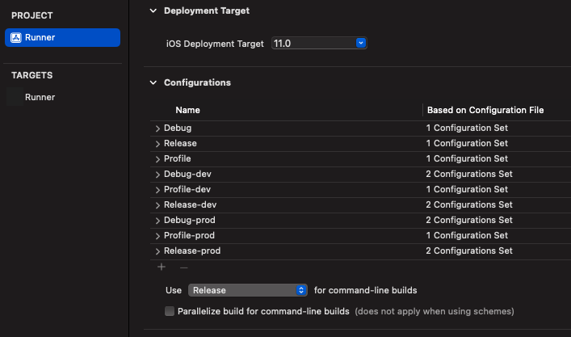

即有这些 flavor：

- `Debug-dev`
- `Profile-dev`
- `Release-dev`
- `Debug-prod`
- `Profile-prod`
- `Release-prod`

这些 flavor 需要添加到 `Unity-IPhone` 工程。

2. 进入 `Unity-IPhone` 工程 -> PROJECT `Unity-IPhone` -> Info：

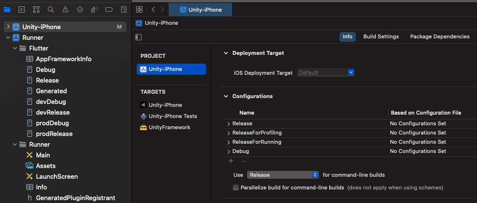

Configurations 区域目前只有：

- `Release`
- `ReleaseForProfiling`
- `ReleaseForRunning`
- `Debug`

3. 复制 `Debug` 配置两次，分别重命名为 `Debug-dev` 和 `Debug-prod`。

操作方式：点 `+` 并复制配置：

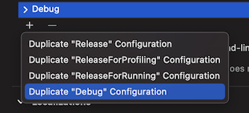

4. 对 `Release` 重复操作，得到 `Release-dev` 和 `Release-prod`。

5. 对 `Release` 再重复操作，得到 `Profile-dev` 和 `Profile-prod`。

6. `Unity-IPhone` 的配置最终应如下所示：

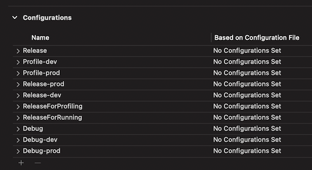

### Web

Flutter 默认不支持 web 构建的 `--flavor`。但运行和构建时可以指定目标 `main.dart` 入口（`-t main.dart`）。只要 flavor 配置得当，web 侧同样无需改动即可生效。

## 已知问题
 - 记得在 Unity Player Settings 中禁用 fullscreen，以关闭 Unity 全屏。
 - Unity 在 Android 上冻结或崩溃时，Graphics API 请使用 OpenGL3。
 - 工程因 Unity 内某些原生依赖构建失败时，请在 Android 或 iOS 上集成对应依赖的原生库
 - 应用退出再进入场景时崩溃的话，这样做：
   > Build Setting - iOS - Other Settings - Configuration - Enable Custom Background Behaviors or iOS
 - Unity 2022.1.* 的 Android 构建耗时极长时，从 unityLibrary/build.gradle 文件删除以下行：
   > commandLineArgs.add("--enable-debugger")
   > commandLineArgs.add("--profiler-report")
   > commandLineArgs.add("--profiler-output-file=" + workingDir + "/build/il2cpp_"+ abi + "_" + configuration + "/il2cpp_conv.traceevents")

### Web GL

叠在 UnityWidget 之上的 Flutter 组件无法接收点击或触摸事件。这是 [Flutter 的已知问题](https://github.com/flutter/flutter/issues/72273)，可用 [PointerInterceptor](https://pub.dev/packages/pointer_interceptor) 包解决。

用法示例：

```dart
Stack(
  children: [
    UnityWidget(
      onUnityCreated: onUnityCreated,
      onUnityMessage: onUnityMessage,
      onUnitySceneLoaded: onUnitySceneLoaded,
    ),
    Positioned(
      bottom: 20,
      left: 20,
      right: 20,
      child: PointerInterceptor(
        child: ElevatedButton(
          onPressed: () {
            // do something
          },
          child: const Text('Example button'),
        ),
      ),
    ),
```


我们已在 `/example` 目录的[示例](/example/lib/screens/)中集成了这一用法。


#### 赞助者

欢迎以组织名义支持本项目。捐款将优先用于帮助儿童，其次用于救助需要帮助的人。你的 Logo 将显示在此处并附上网站链接。[[参与赞助](https://opencollective.com/ultimate-backend/contribute)]

<a href="https://opencollective.com/ultimate-backend/sponsor/0/website"></a>
<a href="https://opencollective.com/ultimate-backend/sponsor/1/website"></a>
<a href="https://opencollective.com/ultimate-backend/sponsor/2/website"></a>
<a href="https://opencollective.com/ultimate-backend/sponsor/3/website"></a>
<a href="https://opencollective.com/ultimate-backend/sponsor/4/website"></a>
<a href="https://opencollective.com/ultimate-backend/sponsor/5/website"></a>
<a href="https://opencollective.com/ultimate-backend/sponsor/6/website"></a>
<a href="https://opencollective.com/ultimate-backend/sponsor/7/website"></a>
<a href="https://opencollective.com/ultimate-backend/sponsor/8/website"></a>
<a href="https://opencollective.com/ultimate-backend/sponsor/9/website"></a>

[version-badge]: https://img.shields.io/pub/v/flutter_unity_widget.svg?style=flat-square
[package]: https://pub.dartlang.org/packages/flutter_unity_widget/
[license-badge]: https://img.shields.io/github/license/yinjianjun1/flutter_unity_widget.svg?style=flat-square
[license]: https://github.com/yinjianjun1/flutter_unity_widget/blob/master/LICENSE
[prs-badge]: https://img.shields.io/badge/PRs-welcome-brightgreen.svg?style=flat-square
[prs]: https://makeapullrequest.com
[github-watch-badge]: https://img.shields.io/github/watchers/yinjianjun1/flutter_unity_widget.svg?style=social
[github-watch]: https://github.com/yinjianjun1/flutter_unity_widget/watchers
[github-star-badge]: https://img.shields.io/github/stars/yinjianjun1/flutter_unity_widget.svg?style=social
[github-star]: https://github.com/yinjianjun1/flutter_unity_widget/stargazers

## 贡献者 ✨

感谢这些出色的贡献者（[emoji key](https://allcontributors.org/docs/en/emoji-key)）：

<!-- ALL-CONTRIBUTORS-LIST:START - Do not remove or modify this section -->
<!-- prettier-ignore-start -->
<!-- markdownlint-disable -->
<table>
  <tr>
    <td align="center"><a href="https://www.xraph.com"><br /><sub><b>Rex Raphael</b></sub></a><br /><a href="https://github.com/juicycleff/flutter-unity-view-widget/commits?author=juicycleff" title="Code">💻</a> <a href="https://github.com/juicycleff/flutter-unity-view-widget/commits?author=juicycleff" title="Documentation">📖</a> <a href="#question-juicycleff" title="Answering Questions">💬</a> <a href="https://github.com/juicycleff/flutter-unity-view-widget/issues?q=author%3Ajuicycleff" title="Bug reports">🐛</a> <a href="#review-juicycleff" title="Reviewed Pull Requests">👀</a> <a href="#tutorial-juicycleff" title="Tutorials">✅</a></td>
    <td align="center"><a href="https://stockxit.com"><br /><sub><b>Thomas Stockx</b></sub></a><br /><a href="https://github.com/juicycleff/flutter-unity-view-widget/commits?author=thomas-stockx" title="Code">💻</a> <a href="https://github.com/juicycleff/flutter-unity-view-widget/commits?author=thomas-stockx" title="Documentation">📖</a> <a href="#question-thomas-stockx" title="Answering Questions">💬</a> <a href="#tutorial-thomas-stockx" title="Tutorials">✅</a></td>
    <td align="center"><a href="https://krispypen.github.io/"><br /><sub><b>Kris Pypen</b></sub></a><br /><a href="https://github.com/juicycleff/flutter-unity-view-widget/commits?author=krispypen" title="Code">💻</a> <a href="https://github.com/juicycleff/flutter-unity-view-widget/commits?author=krispypen" title="Documentation">📖</a> <a href="#question-krispypen" title="Answering Questions">💬</a> <a href="#tutorial-krispypen" title="Tutorials">✅</a></td>
    <td align="center"><a href="https://github.com/lorant-csonka-planorama"><br /><sub><b>Lorant Csonka</b></sub></a><br /><a href="https://github.com/juicycleff/flutter-unity-view-widget/commits?author=lorant-csonka-planorama" title="Documentation">📖</a> <a href="#video-lorant-csonka-planorama" title="Videos">📹</a></td>
  </tr>
</table>

<!-- markdownlint-enable -->
<!-- prettier-ignore-end -->
<!-- ALL-CONTRIBUTORS-LIST:END -->

本项目遵循 [all-contributors](https://github.com/all-contributors/all-contributors) 规范，欢迎任何形式的贡献！
